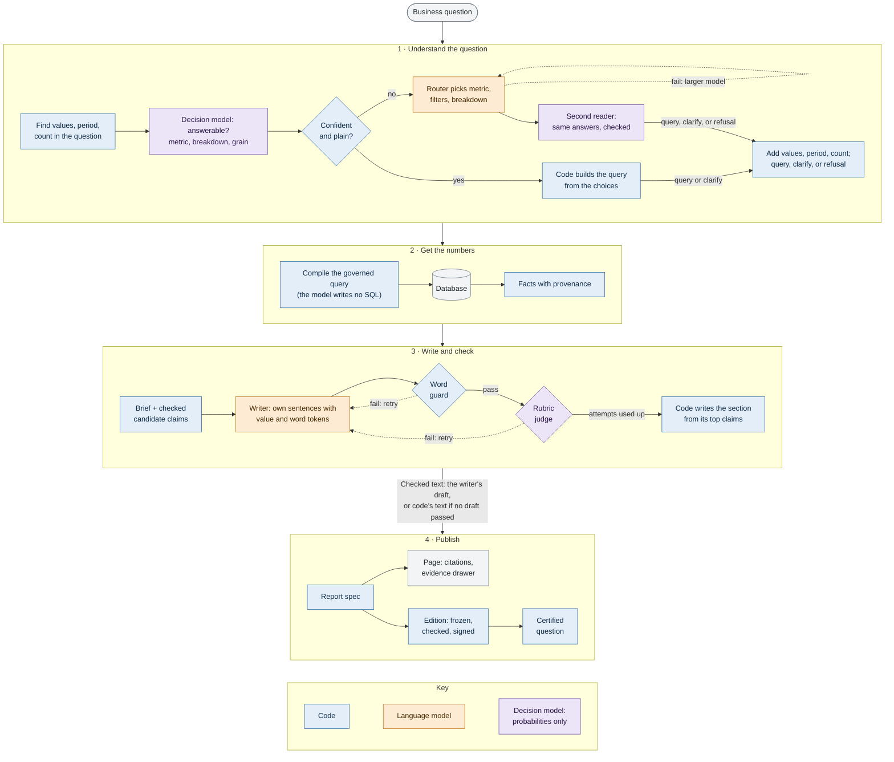

# Code-Checked Narration: Design Patterns for Numeric Business Reports from Small Language Models

Technical report. It describes the design of the narration pipeline in the Folio codebase (package `living_reports`). Folio is an educational demo app. The design was tested on generated datasets, and every example in this report comes from that testing (section 3). The report makes no quantitative claim about the factuality of the narration: section 9 says what was measured and what was not.

Code: <https://github.com/spkc83/folio> (Apache License 2.0).

## Abstract

A report that a language model writes from query results has two kinds of content: numbers, and statements about numbers. Number tokens make the numbers traceable, but trend, rank, comparison, and cause words between the tokens are still free text, and a model can get them wrong while every number around them is right. This report describes an architecture in which the model writes templates and code writes the facts. Code computes the values from governed queries. It then lists the candidate claims a section supports (values, comparisons, ranks, shares, extremes, changes, trends, targets, and peaks) and renders each claim from a template with its receipt. Business knowledge in the semantic model, the better direction of a metric and its target, lets code also render judgments such as "a change for the worse" and "misses the target", so the model does not state them. The model chooses which claims to cite, puts them in order, and writes the sentences. Each value and each finding word in a sentence ("highest", "below", "rose sharply") is a token that code renders from a claim. A deterministic word guard rejects listed trend, rank, comparison, and cause words outside a token. A decision-model rubric scores what code cannot define. A bounded loop ends in a section that code writes from its top claims, so no draft that failed a check is published. The same pattern runs through the rest of the pipeline: a query schema closed over the semantic model's vocabulary, a semantic engine that owns SQL, a decision model that routes plain questions and reads every other route a second time, code that fills the router's gaps and shows each repair, an escalation ladder, a sandboxed code mode, and frozen, checked editions. We state what each mechanism checks deterministically, what it only makes likely, and what it does not cover. The working hypothesis is that correctness comes from the architecture and quality comes from the model. We measure whether reports state stories planted in the data, and we give an evaluation plan to test the hypothesis across model sizes.

## 1. Introduction

### 1.1 The problem

A business reader asks a question in plain words and expects a short report: a few numbers, a chart, and some sentences that say what the numbers mean. The numbers are the easy part to make correct, because a query computes them. The sentences are the hard part. A sentence such as "revenue in the North is consistently increasing" has no number in it, so a check on numbers does not see it. If the series went up, down, and up, the sentence is false.

Small language models make this kind of error often, and larger models make it less often. No model size removes it. A system that must publish reports with no unsupported statement about the data therefore cannot depend on the model being accurate. It must make sure that no statement about the data reaches the page unless code checked it.

### 1.2 Error classes

The design addresses the error classes below. Each example comes from testing on the generated datasets (section 3) or from the data-to-text literature (Wiseman et al., 2017; Maynez et al., 2020).

| # | Error class | Example | What the reader sees |
|---|---|---|---|
| T1 | Unsupported claim | "North revenue is consistently increasing" over $2.7M, $3.4M, $3.1M, $2.8M | A plausible sentence with no number in it |
| T2 | Wrong aggregation word | "an average revenue of $42.4M" where the value is a total | A correct number under the wrong noun |
| T3 | Cause or forecast | "driven by the holiday season," "will keep rising" | A cause or a forecast that the values cannot show |
| T4 | Silent truncation | The model sees 40 of 115 values and calls the first half of the series a peak | A statement about a subset the reader cannot see |
| T5 | Wrong question | A question about the number of stores answered with the number of sale lines | A correct report on the wrong metric |
| T6 | Invented or copied value | A digit typed from memory, or one value attached to another label | A number with no trace, or a wrong trace |
| T7 | Format failure | A small model fills one JSON field until it reaches the token cap | No answer, or a very expensive one |
| T8 | Injection through data | A dimension value that contains instructions | The model follows the data instead of the task |

### 1.3 Terms

- A **fact** is a value that the semantic engine computed from a governed query. It records the query hash, the metric version, the source, and the data time.
- A **claim** is a typed statement that code computes from facts, renders from a template, and can check again (section 5, P6).
- A statement is **code-checked** when code rendered it from facts through a rule that code owns, and the system can show the reader the receipt: the values, the query, the metric definition, the period, and the segment.

A code-checked statement is correct *relative to its facts*. Facts are as correct as the query engine and the semantic definitions. Tests cover both, but neither is formally proved. Section 6.2 gives an example of an error below the facts that no narration check can see.

### 1.4 Contributions

1. An architecture in which the model is a template writer: it writes its own sentences, and every value and every finding word in them is a token that code rendered and checked (P6, P7).
2. A set of patterns that keep each model step inside a boundary that code defines, from query routing to publication (P1 to P15).
3. A table of what each mechanism checks, what it only makes likely, and what it does not cover (section 6).
4. An evaluation of whether reports state planted stories (section 9.3), and a plan for narration factuality across model sizes (section 9.4).

## 2. Related work

### 2.1 Data-to-text generation

Data-to-text has a long history of template and rule systems (Gatt and Krahmer, 2018). Neural approaches write more fluent text but add content that the data does not support. Wiseman, Shieber, and Rush (2017) introduced the RotoWire corpus and showed that neural models wrote fluent game summaries that did not match the box scores, while a template baseline beat them on some extractive metrics. Dhingra et al. (2019) showed that reference-based metrics correlate poorly with human judgment when the reference diverges from the table, and proposed PARENT. The design in this report follows the lesson of this line: templates over computed values carry the facts, and the model only selects and connects. It differs from classical template systems because the model decides which templates to use and in which order.

### 2.2 Constrained and structured decoding

Willard and Louf (2023) showed that generation under a regular expression or a grammar can be an index over the vocabulary with small overhead (Outlines). Geng et al. (2023) showed that grammar-constrained decoding is a general framework for structured tasks. Tam et al. (2024) found that strict format restrictions can degrade reasoning, and that separating content from format helps. The design uses schema-constrained decoding where the backend supports it and validates every output on every backend. The schema also carries meaning: the router schema's enums are the semantic model's vocabulary (P2). The caution in Tam et al. also applies here: a schema forces valid JSON, not short or sensible JSON.

### 2.3 Semantic layers and natural language to SQL

BIRD (Li et al., 2023) and Spider 2.0 (Lei et al., 2024) show that text-to-SQL is far from solved on realistic schemas. The common industry response is a governed semantic layer between the model and the warehouse, so that the model chooses among defined metrics instead of writing SQL. Vendor features such as verified query repositories and trusted assets let a person certify a question and its query. The design takes the same position: the model never writes SQL for a governed report, the query form is a closed JSON schema that code compiles, and a published section becomes a certified question.

### 2.4 Program-aided reasoning

PAL (Gao et al., 2023) and Program of Thoughts (Chen et al., 2023) showed that a model is more accurate at numerical reasoning when it writes a program and an interpreter computes. Binder (Cheng et al., 2023) binds model calls into SQL or Python programs over tables. Industry write-ups on code execution with MCP tools describe the same move for tool use. The design's code mode (P11) follows this pattern. Generated code runs in a sandbox with no permissions, and every value it produces enters the report through the same fact records and validator as the single-query path.

### 2.5 Attribution and factuality evaluation

Maynez et al. (2020) showed that abstractive summarizers state content that the source does not support. Rashkin et al. (2023) defined Attributable to Identified Sources (AIS). Gao et al. (2023, ALCE) built a benchmark for text with citations. Liu, Zhang, and Liang (2023) found that only about half of the sentences from generative search engines were fully supported by their citations. Min et al. (2023) proposed FActScore, which splits long text into atomic facts and scores the share that a source supports. Proof-Carrying Numbers (Solatorio, 2025) emits numbers as claim-bound tokens that a renderer-side verifier marks as verified or not, and it fails closed. The `{fact:id}` token in this design is the same idea. The claims layer extends it from numbers to statements, with one difference: code generates the candidate claims and the model selects them, instead of code checking claims that the model proposed. In a closed claim language, every claim that can appear is one that code already evaluated.

### 2.6 Language models as judges

Zheng et al. (2023) showed that a strong model as a judge agrees with human preferences at about the human-human rate, with position and verbosity biases. G-Eval (Liu et al., 2023) scores generated text with chain-of-thought and form filling. The design uses a judge only under code. The rubric judge is a decision model that returns probabilities for yes-or-no questions. It never writes text, and it runs only after the deterministic checks pass. It can send a draft back, but it cannot pass a draft that code rejected.

### 2.7 Solvers and verification

Z3 (de Moura and Bjørner, 2008) is the reference SMT solver. Logic-LM (Pan et al., 2023) has a model translate a problem into a symbolic language for a solver. Proof-carrying code (Necula, 1997) ships a proof that a simple checker on the consumer side can verify. Claim tokens borrow the shape of that idea without its formal content: the receipt travels with the claim, but there is no proof object. Section 6.4 says why the design uses no solver and when one would be useful.

## 3. Test setting

All examples in this report come from testing the codebase on generated datasets. The data is generated, not observed, and its values have no meaning outside the tests.

- **Data.** A generated retail dataset of 400,000 sale lines in 120 stores, from January 2024 to December 2025. The examples read it as known on 30 November 2025, which gives 368,137 sale lines. The semantic model has three datasets: sales, stores, and products, with many-to-one joins from sales to stores and from sales to products. Dimensions include region (four values), store format (three), product category (five), channel, and customer segment. Metrics include revenue (sum of the sale value after discounts), gross profit, gross margin, return rate, units, discounts, and store count.
- **Routing datasets.** Three generated datasets: the retail dataset above, card payments, and HR. Each one covers January 2024 to December 2025, has 290,000 to 400,000 fact rows and its own semantic model, and comes with 31 or 32 evaluation questions. Section 9.2 uses them for the routing results.
- **Totals used in the examples.** Revenue is $42.41M. By region it is East $14.19M (33.46%), North $11.88M (28.02%), West $9.24M (21.79%), and South $7.09M (16.73%), with 104,290 North sale lines. Gross margin is 33.46% against a target of 35%; the Outlet store format has 25.60%.
- **Models.** Local open models act as stand-ins for size classes: a 1.5B coder model as the writer and router, a 7B and an 8B model for comparison, and 2B and 4B decision models for the second reader and the judge. They show the trend with model size. They are not the models a deployment would select. On the three routing datasets, a small hosted language model writes the text and routes what the decision model does not route.
- **Tests.** The automated test suite uses a deterministic stand-in for the model. It proves the behavior of the code, not the quality of any model.

## 4. Architecture

### 4.1 The pipeline



Read the diagram from top to bottom. A question passes through four stages: understand it, get the numbers, write and check the text, and publish. Blue steps are code, orange steps are a language model, and purple steps are a decision model that returns probabilities and never text. In stage 1, the decision model routes a plain question, and the router is called only when code finds the decision unsure or the question beyond a choice (P4). The two orange steps only choose among options that blue steps defined: the router chooses from the semantic model's vocabulary, and the writer chooses from the checked claims. In stage 3, a draft that fails the word guard or the judge goes back to the writer. When the attempts are used up (after the ladder tries the frontier tier, P10), code writes the section from its top claims. The report is a declarative `ReportSpec`, and one fixed renderer turns it into HTML. The model never writes page code.

### 4.2 The trust boundary

```
 +------------------------------------------------------------------+
 |  Model may write                 |  Code owns                    |
 |----------------------------------|-------------------------------|
 |  objective (one of four words)   |  the vocabulary (enums)       |
 |  query ids from the vocabulary   |  SQL, join paths, parameters  |
 |  assumptions (text, checked)     |  every value (facts)          |
 |  title, heading (no tokens)      |  every derived value          |
 |  sentences with value, word,     |  every claim and its receipt  |
 |    and claim tokens (guarded)    |  the word list                |
 |  action text + basis claim ids   |  the loop bound, the fallback |
 |  TypeScript in code mode         |  the sandbox, the tools       |
 +------------------------------------------------------------------+
```

The invariant: *no number and no listed kind of statement about numbers reaches the page except through a token that code rendered from values that code computed.* The invariant says nothing about whether the values answer the reader's question, whether the chosen claims are the fair ones, or whether an opinion in the connecting text is sound. Section 6 covers these limits.

### 4.3 Facts

A `Fact` is the unit of provenance. Its fields include an id (`q1.revenue.North`), a label (`Revenue · North`), the value, the formatted value (`$11.9M`), the query hash, the metric and its version, the data time, a state (`ok`, `empty`, or `undefined`), and the metric definition. The query hash covers the SQL text, the parameters, and the plan (base datasets, joins, group columns, time field, and versions). An edition records when it was frozen and the graph version at that time, so its queries can be compiled again as they were.

Derived facts use the same record. Code computes half-year totals, ratios, and percent changes from a section's results. A derived fact carries the source query's hash and the metric's definition, so the trace, the evidence drawer, and the checker treat it like any other fact.

## 5. Design patterns

Each pattern has an intent, the forces that make it necessary, the solution in the codebase, its consequences, and an example from the retail dataset (section 3).

### P1. Tokens, not numbers

**Intent.** Prevent the model from putting a number on the page.

**Forces.** Small models copy, round, and invent numbers. A number in prose cannot be traced to a query after the fact.

**Solution.** The model writes `{fact:id}` where it wants a value. `check_text` in `spec/validate.py` rejects any digit or number word outside a token, except date labels and category labels that contain digits (such as the tenure band `1-3 years`). The renderer shows each token as the formatted value with a chip that opens its provenance. `tokenize_values` repairs a common small-model habit, a copied value instead of a token, but only when the copied text matches exactly one fact. A value shared by two facts stays raw and is rejected, because a wrong trace is worse than no answer.

**Consequences.** Every number has a trace. Small models fail this check often at first, so the repair note says exactly what to change.

**Example.** For "What is the revenue by region?", the model writes "The North had {fact:q1.revenue.North} of {fact:q1_total.revenue}." The page shows "$11.9M" and "$42.4M" as chips. A draft that typed "$11.9M" itself is rejected.

### P2. Vocabulary-closed structured output

**Intent.** Prevent the model from naming a metric, a dimension, or an operator that the semantic model does not have, and keep every call bounded.

**Forces.** Some backends constrain decoding and some do not. A recursive schema produces a large grammar. A schema forces valid JSON, not short JSON, and grammar engines have their own limits.

**Solution.** Every model call sends a JSON schema. The router schema comes from the `Query` model and is then rewritten: the metric, dimension, and filter-member enums are the semantic model's ids, and the small tier gets four filter operators (`eq`, `ne`, `in`, `not_in`) while the frontier tier gets all of them. Filter groups are removed from the router schema to keep the grammar small. `bound_schema` in `harness/llm.py` gives each array a `maxItems` and each free string a `maxLength`, and caps every declared bound at 1,999. Each call is capped at 2,048 output tokens (`MAX_OUTPUT_TOKENS`). Backends that ignore the schema get the same validation and a repair call.

**Consequences.** The model cannot write an id that does not exist. The small tier cannot write a `between` filter, which is an intended loss of expressiveness. Two limits are easy to miss: the llama.cpp grammar engine rejects a schema with any bound of 2,000 or more ("failed to parse grammar"), so every call fails; and without bounds, a small model can fill one string field until it reaches the token cap. Structured output removes format failures (T7), not query-choice failures (T5).

**Example.** The router writes `region`. Code maps it to `stores.region` through a name table, because a bare name is easier for a small model and the member id is what the engine needs.

### P3. Code fills the gaps

**Intent.** Use what the question states explicitly, found by code, to repair the router's omissions without overriding its choices.

**Forces.** Small routers drop a filter, a period, or a limit that the question names. They sometimes break down by a dimension and also filter it to one value. The reader must see every repair.

**Solution.** Before any model call, code finds three things in the question: a whole-word value of a small dimension ("Online"), one explicit period ("in 2024," "last quarter"), and a count ("top 3"). After the router answers, `fill` adds a missing filter, time bound, or limit, and removes a breakdown that is filtered to one value. It never changes a choice the router made. Each repair becomes an assumption that the page shows. If the filled query does not compile, the router's query stands.

**Consequences.** A half-bound period is the common case. For "What was the revenue in 2024?" the router wrote a start date only, and code added the end. Without the end, the answer would include all later data.

**Example.** "Gross margin by channel, where the channel is Online" routes to a breakdown with a filter on Online. `fill` removes the breakdown and adds the assumption "One Channel, so no breakdown." The report shows one number instead of a chart with one bar.

### P4. A decision model as router and second reader

**Intent.** Read the question with a model that cannot write text and so cannot add an error of kinds T1 to T4. Let it choose the query when the choice is plain, and check the router's choice when it is not.

**Forces.** The router is the one point where the wrong question (T5) is chosen. A second generative call doubles the surface for generation errors. A probability supports a threshold decision, not a guarantee. A choice over the metrics always selects one, so a vague question gets the nearest metric with high probability.

**Solution.** One decision request asks four typed questions: a yes-or-no question ("Can one of the metrics answer this question from past data?"), a choice over the metric ids, a choice over the breakdowns ("none" or one dimension), and a choice over the grains ("none" or one period). Code builds the query from the answers when all of these hold:

- Each answer is above a confidence floor (0.8 in testing).
- The question names its metric by label or synonym. A name inside a longer name does not count alone, so "voluntary attrition rate" names one metric.
- The question names at most one metric and at most one dimension that it does not filter.
- The question has no word that a choice cannot express: an exclusion, a threshold, "per", "ratio", or a request for rows.

Code then adds what P3 finds: the values, the period, and the count. One case skips the first two conditions: when the top two metrics are close, the outcome is a clarify question between them, with no language-model call. Two rules belong to code, not to the model. A question with no time word ("month", "trend", "over time", "growing") gets no grain, and a named period that is not longer than the grain gets no grain. A question that asks how a value moves ("changing", "moving") and gets no grain from the decision model goes to the language-model router. A question about a change "after" or "since" a date gets a series that also covers the months before that date. Without these months, no claim can compare the two parts.

In every other case the router answers, and the same answers act as a second reader. `reconcile` turns them into a doubt, a clarify question, or no change. A *doubt* when the router answered and the model finds the question not answerable, or when the router refused and the model is confident of one metric: the ladder asks the next rung. A *clarify* with two options when the top two metrics are close and the router chose one of them, when the model is confident of a metric that the router did not choose, or when the question names no metric at all. In the last case the router's metric is a guess, and the second option is the decision model's most probable other metric. A name counts when the question has the metric's label, a synonym, or the last word of the label ("profit" for "Gross profit"). Each option is compiled and run before the page shows it. If the options give the same rows, the router's query stands.

**Consequences.** The probabilities are not calibrated, and the thresholds are settings. The thresholds and the route mode are part of the answer-cache key, so a changed threshold never serves an old answer. In testing, a 2B decision model refused answerable questions, while a 4B model added correct refusals and clarify questions. As the router, the 4B model routed 61 of 94 questions on three datasets, and each of the 61 was correct (section 9.2). The time-word rule exists because of data shape: on data with one row per employee and month, the model gave "by month" 0.54 and "not over time" 0.44 for "What is the overall attrition rate?".

**Example.** "Give me the top 3 departments by leavers." The decision model gives leavers, department, and no grain. Code adds the limit 3, and no language model is called. "How big is the problem by category?" names no metric, so it shows two chips, each a different metric by category, and the reader chooses.

### P5. The data brief: nothing is cut silently

**Intent.** Give the writer a complete, shaped view of what was counted, so that T4 cannot occur and the model does no arithmetic.

**Forces.** A section can have more facts than a small model can read (a breakdown by five categories over 23 months has 115). A flat list of facts has no shape. A prompt that drops facts to fit must say so, or the model describes the subset as the whole.

**Solution.** For each section, `build_brief` in `harness/brief.py` builds a `DataBrief` with the question, a `counted` line, a table, the claim options, and one context line for each earlier section. The table has at most 12 rows and 8 columns (`MAX_ROWS`, `MAX_COLUMNS`). When the result is larger, code rolls the time grain up (month, quarter, half-year, year), keeps the top members with an "Other" row for additive metrics, and states the roll-up in the table. The row count comes from a row-count query on the same filters. All labels are display labels (`Click & collect`, `Jan 2024`).

**Consequences.** The model never sees a silent subset. The claims (P6) use the same rolled-up series, so the text and the table agree. The cost is resolution: for a long series the model can speak of half-years, not months.

**Example.** For North revenue by category and month, the 115 monthly facts become a table of four half-year periods by five categories plus a total. The `counted` line reads "Revenue · Region is North · by Category and month · Jan 2024 – Nov 2025 · 104,290 sales."

### P6. Claims: code checks, the model places

**Intent.** Put every statement about numbers, not only the numbers, behind a token that code renders from values it computed.

**Forces.** Trend, rank, comparison, share, extreme, change, target, and peak are the sentences a business reader wants, and they are the sentences a model gets wrong. Code can fully check a closed set of claim kinds but not an open set. The model is good at choosing what matters and poor at arithmetic.

**Solution.** A `Claim` (in `spec/models.py`) has an id, a kind, the rendered text (which can hold `{fact:id}` tokens), the list of facts it cites, the query reference, the segment, the inclusive period, the evidence for the drawer, and `params`: the words that are not values, so that code can derive the text again. `claims_for` in `harness/claims.py` lists at most 40 candidates for a section (`MAX_CLAIMS`), ordered by salience: a member that the question names comes first. `derive(kind, params, facts)` renders a claim and returns `None` when the facts do not support it. `check(claim, facts)` is true when the facts still give the exact text.

The vague words are defined in one place. "Flat" means a change within 2% (`FLAT = 0.02`). "Rose sharply" and "fell sharply" mean a change of 20% or more (`SHARP = 0.20`), and never across a partial period. A trend says "rose in every half-year" only when every step rises. Otherwise it says "rose in N of M half-years," "fell in N of M half-years," or "went up and down," and it names the flat steps: "fell in 1 of 5 months and was flat (within 2%) in 4." A peak is one month at least twice the median of the other months (`PEAK = 2.0`, at least 6 months), and each neighbor month is at most half of it, so a rise to the last month or a level of two high months is not a peak. A rate cannot be summed from its months: over more than 6 months, the query engine computes its series by quarter, and the claims use the last 6 quarters. A rank or an extreme says "the most" and "the fewest" for a count ("the most leavers"), and "the highest" and "the lowest" for every other metric. A member at either end gets an extreme claim and no rank claim, so the same fact is not stated twice. A partial period has its real span as its label ("Jul–Nov 2025"), and a change into it says "a partial period."

Code orders the claims of a section by salience. A member that the question names leads. One rule is for a section that filters to one named member and breaks down by another dimension, as a follow-up "Electronics by Brand" does. The earlier section already stated the member's level, so this section leads with the member's largest change. A change in the wrong direction for its metric comes before a change in the right direction. Example: "Gross margin for Electronics fell sharply" leads a rise in Electronics revenue, and the brand with the highest revenue comes second. A second rule is for a question that asks how a value moves ("changing", "grew", "trend") by a dimension over time, and names no member. That section leads with the member's change that is largest in size, and the trend of the total comes second. Example: for "How is revenue changing by channel?", the first claim is "Revenue for Online rose sharply from $2.4M in 2024 H1 to $4.7M in 2025 H2 (+95.2%), a change for the better" (retail data at moment 2). Without the rule, the two leading claims were the trend of the total and the channel with the highest revenue, and no text named the channel that grew.

The model writes its own sentences with three kinds of tokens. A `{fact:id}` token is a value. A `{word:id}` token is the finding word of a claim, which `word_of` in `harness/claims.py` derives from the same facts as the claim's text: "highest" or "lowest" (or "most" and "fewest" for a count), "2nd highest" for a rank, "below", "above", or "at" for a target, "rose", "fell", "rose sharply", or "stayed flat" for a change, and the step summary of a trend ("went up and down"). A value, a share, a comparison, and a peak have no word. A `{claim:id}` token is the claim's full sentence. Example (retail data): the writer writes "Electronics gross margin was {fact:…}, {word:…} the target of {fact:…}.", and the page shows "Electronics gross margin was 25.70%, below the target of 35.00%." The writer chooses the sentence, and code chooses the word, so the word cannot contradict the facts. Earlier versions had only full-claim tokens, and the model wrote connecting words around fixed sentences; the reports were correct but read like a list.

The model can propose claims, but it never writes one. Once for each section, a draft can name up to 3 members of the table (`focus`) and up to 2 comparisons with a member of an earlier section (`cross`). Code gives a focus member the claims of a member that the question names, but below the section's leading claims (`FOCUS_SCORE`): in the insight evaluation, a focus member that led took both covered slots and pushed out the claims that stated the planted story. Code computes a comparison across sections only for the same metric over the same period, and each side names its section's filters: "West (all)" and "West (Web)". The writer then drafts again with the new claims. The section stores its focus, and the checker derives a cross-section ratio again from the two facts, so both stay checked after a refresh.

| Kind | Rendered text from the retail data | What code checks |
|---|---|---|
| value | Revenue for North was $11.9M (Jan 2024 – Nov 2025) | the fact exists and its state is ok |
| compare | East's revenue ($14.2M) was 1.2× North's ($11.9M) | the ratio fact equals a ÷ b |
| rank | North ranked 2nd of the 4 regions by revenue ($11.9M, 28.02% of the total) | the order over all members |
| share | North made up 28.02% of revenue | the share is between 0 and 1 |
| extreme | East had the highest revenue of the 4 regions ($14.2M, 33.46% of $42.4M) | strictly larger than every other member |
| change | Revenue for North rose from $2.7M in 2024 H1 to $2.8M in Jul–Nov 2025, a partial period (+5.0%), a change for the better | the percent fact equals (b − a) ÷ \|a\| |
| trend | Revenue for North went up and down: $2.7M in 2024 H1, $3.4M in 2024 H2, $3.1M in 2025 H1 | the sign of each step, over full periods only |
| target | Gross margin for Outlet was 25.60%, which misses the target of 35.00% | the value against the target, in the better direction |
| peak | Voluntary attrition rate for Finance peaked at 1.41% in Mar 2024, 3.2× the median month (0.44%) (HR data, Jan–Jun 2024) | the strict maximum of all months, at least twice their median, and each neighbor at most half of it |

The words "the best result", "a change for the better", and "misses the target" come from the metric's business fields (P15). Without them, the same claims carry no judgment. The rank and the extreme above carry no "best" or "worst", because revenue is a sum (P15).

**Consequences.** A claim on the page is true of its facts, because code computed it from them. The claim language is closed: the reader does not see "grew steadily" unless a claim of that kind exists. New kinds are added in code, each with a template, a check, an evidence shape, and tests (section 8.3). The receipt is explicit: `facts` lists the values the sentence depends on, which is what the evidence drawer shows.

### P7. The word guard

**Intent.** Prevent the text between tokens from stating a trend, a rank, a comparison, a judgment, or a cause.

**Forces.** A closed claim language helps only if the model cannot go around it in free words. A word list is crude and rejects some innocent sentences. A deterministic rule is easy to explain to a model in a repair note and to an auditor in one line.

**Solution.** Outside tokens, `validate_spec` rejects any digit and any number word (P1), an aggregate word that contradicts a fact's aggregate ("average" next to a sum), and any word in `CLAIM_WORDS`. That pattern joins `FINDING_WORDS` (trend words such as `increas*`, `declin*`, `rose`, `fell`, `consistent*`, `steadil*`; rank and comparison words such as `highest`, `lowest`, `largest`, `the most`, `more than`, `exceed*`, `outpac*`; judgment words such as `worse`, `best`, `improv*`, and `missed the target`) with `CAUSE_WORDS` (`because`, `due to`, `driven by`, `caused`, `led to`, `result of`). A title or a heading must contain no token. A recommendation is checked for cause words only, and it must list `basis` claim ids that exist. Each `{claim:id}` and `{word:id}` must name a known claim. A sentence with a word token must hold one of the claim's own values (`own_values`: its value, the ends of its change, or a point of its trend), name the members that the claim is about (`Claim.about`), and name no other member of the report. "Not" or "never" just before a word token is rejected (`check_word_tokens` in `spec/validate.py`). Example: "West had the {word:…} fraud loss at {fact:…}", with South's value, is rejected. `tokenize_claims` turns a copied claim text back into its token, and `token_hint` adds the token to write to the repair note. Style checks in `style_problems` (`harness/builder.py`) follow: no two sentences can start with the same words, and a section can cite at most five claims (`MAX_CITED`). Both target what a model does when every sentence must be a claim: it opens each sentence with the same phrase, and it lists every claim instead of choosing. Three more rules in `ste_problems` apply a part of ASD-STE100 (Simplified Technical English) to the writer's own words: a sentence has at most 25 words, with each token as one word; a sentence cites at most two claims; and a short list of hard words gets plain words ("use", not "utilize"). Each rule goes back to the writer as a repair note, the same as a guard word. The judge (P8) does not read the title or the heading. A 4B judge read plain labels such as "Trend over time." as stated facts, so only the word guard checks a title, and a title such as "Online leads revenue" can state a ranking that no check catches.

**Consequences.** For the listed words the check is deterministic: "North revenue is consistently increasing" cannot be published. The list is not closed under paraphrase. "Climbing," "peaked," "leads," and "North is the growth engine" contain no listed word and reach only the rubric judge (P8), which is probabilistic. A fluent model can state a comparison in unlisted words, and the judge is then the only check before the page. Some innocent phrases ("the most important point") are rejected, which raises retries and fallbacks for small models. A fallback is correct and plain, so this cost is accepted.

### P8. The rubric judge

**Intent.** Lower the rate of the errors that code cannot define, with a model that returns probabilities and never text.

**Forces.** Paraphrased claims, a missing key point, a text that does not answer the question, and a recommendation that does not follow from its basis are judgments, not computations. A generative judge adds a generation surface; a decision model does not.

**Solution.** After the code checks pass, `rubric` in `harness/judge.py` gives the decision model (`LR_JUDGE_MODEL`, by default `LR_DECIDE_MODEL`) the brief and the rendered text, and asks up to four yes-or-no questions against `LR_JUDGE_FLOOR`:

- R1: Do the writer's own words add a fact, a comparison, a trend, or a cause that the tokens do not state, such as "slightly" or "strong growth"? (must be no) The judge reads the text with each claim masked as "[cited claim]", each word as "[cited word]", and each value as "[value]". With word tokens, the writer's sentences state findings by design; R1 asks only about what the writer adds to them. If the remaining words are only connecting words ("also", "by contrast"), code passes R1 without a model call.
- R2: Does the text answer the question? (must be yes)
- R3: Is the most important claim in the brief left out? (must be no)
- R4: Does the recommendation follow from the claims it cites? (must be yes; asked only when there is a recommendation)

Each failed item becomes a line of the repair note. With no judge configured, the rubric is skipped and the code checks still apply.

**Consequences.** The judge can only send a draft back. It cannot pass a draft that code rejected. The floor is part of the answer-cache key. An item stays in the rubric only if the judge answers it reliably. Two more questions were tested and removed. "Does the text cite claims that do not help answer the question?" made a four-billion-parameter judge reject "Order value was $929.8M" as the answer to "What is the total order value?"; a code limit on the number of claims replaced it. "Does the first sentence answer the question?" rejected the same drafts as R2 when it was right. When it was wrong, it rejected a missed target that code had put first on purpose (P15).

The judge's pass is a probability, and a reader must not take it for the proof that a claim has. Each section therefore stores a `review` record, and the Evidence view shows three lines for each section. The numbers are "Checked against the data". The words between them are "Only connecting words. Checked by code.", "Reviewed by a second model. Probable, not proven.", "Fixed sentences that code wrote.", or "Not reviewed." What the text leaves out (R3) is at best "Probable, not proven". The evidence of a claim repeats the line for the words around it. Example: "Online had the highest return rate of the 3 channels (7.15%), the worst result" is a true claim. The words "Online customers are happy with their orders:" in front of it pass the word guard (P7), and only R1 can reject them. A refresh that moves a value that the judge read marks the review as older than the data, because a sentence that fit the old value can mislead with the new one.

### P9. A bounded loop with a code-only fallback

**Intent.** End with a section whose statements about numbers are all checked claims, whatever the model does.

**Forces.** A small model may never pass the word guard. An unbounded loop has an unbounded cost. A correct, plain report is better than no report, and much better than a wrong one.

**Solution.** `write_checked` in `harness/builder.py` allows at most `LR_NARRATE_ATTEMPTS` drafts (default 3). Before the checks, code applies a coverage rule (`_with_lead_claims`): the prompt names the two most salient claims (`COVERED = 2`), and if a draft leaves out one of them, code puts it first. A rule for one claim was not enough: in the insight evaluation, for "What is the absence rate by department?" on the HR data, a writer cited "Absence rate for Customer support was 5.08%, which misses the target of 3.00%" (the first claim) and left out "Customer support had the highest absence rate of the 6 departments (5.08%), the worst result" (the second). If every draft fails and a frontier model is configured, the ladder asks it first (P10). After the last failure, `code_words` writes the section: a heading from the query and the top three claims (`CODE_CLAIMS = 3`) as one sentence each, plus the breakdown's leader when a named segment fills the top three. The section has `narration: "code"`, and the page says "Written by code: the model's draft did not pass the checks."

**Consequences.** A draft that a deterministic check rejected is never published. If no draft passes, the only exit is text that code wrote from checked claims. The fallback does not make the judge's pass decisions correct: a draft that the guard accepts and the judge wrongly accepts is published. In informal testing with the 1.5B writer on a generated dataset, sections usually ended in the code-only fallback, because almost every draft had one rejected sentence and the loop accepts or rejects a section as a whole.

### P10. The escalation ladder

**Intent.** Use the cheapest step that gives a valid answer, and move up only when a check fails.

**Forces.** Frontier calls cost money, and cached and certified answers cost nothing. Clarify and out-of-scope answers are correct outcomes and must not escalate. A changed pipeline setting must not serve an answer made without it.

**Solution.** `run_ladder` in `harness/ladder.py` tries, in order: the answer cache; a certified question (no model cost while its definitions hash matches); the small-model rung; code mode when the router marks the question multi-step; and the frontier model when the first rung gave nothing valid or carried a doubt. The cache key holds the normalized question, the source, the data time, the semantic model's content hash, and the pipeline settings (`_pipeline()`): `NARRATION_VERSION`, the attempt count, the decision and judge models, and the thresholds. When every rung fails, the answer is "This question needs a person."

**Consequences.** The useful measure is cost per correct answer. `NARRATION_VERSION` must change when claim rendering changes, or the cache serves text in the old wording.

### P11. Sandboxed code mode with host-side tools

**Intent.** Let a model answer a multi-step question by writing a program, without letting the program reach data, credentials, or the network.

**Forces.** Generated code is untrusted. Some questions ("which channel's gross margin moved most against the prior period, and what is its revenue by category?") do not fit one query. Values from the program must be as traceable as a single query's.

**Solution.** The tools (`metrics_query`, `graph_lookup`, `report_add_section`) are declared to the model as TypeScript. A new Deno process runs the program with `--no-prompt --no-remote --no-npm --no-config`, a V8 heap limit, CPU and wall-time limits, and a clean environment. The only channel is one JSON line per message on stdin and stdout. `metrics_query` runs through the same engine and returns at most 20 rows (`MAX_ROWS` in `sandbox/gateway.py`) plus the fact records. The host then builds each section again and validates it exactly as the single-query path does.

**Consequences.** The model coordinates and the database computes. No more than 20 rows of a result enter the model's context.

### P12. Frozen editions, an independent checker, sign-off, certified questions

**Intent.** Make a published report immutable, checked by rules that the author cannot change, and reusable at no model cost.

**Solution.** A freeze writes the edition and its graph links in one transaction. The checker runs in order: trace the numbers, compare the totals (parts add up to the whole), apply the rules (banned phrases from a file that no route can change, and the metric versions in force at the freeze), challenge the wording (a different model lists causal, predictive, or certainty claims; this step is advisory), and collect sign-off (the owner, plus compliance for a business-critical report). Signatures bind to the content hash. Publishing writes a certified question per section with a hash of the definitions its query reads.

**Consequences.** An edit to a signed edition gives a new hash and voids the signatures. A certified question shows "Definitions changed since" when a definition it reads changes. The checker gives evidence, not regulatory compliance.

### P13. Re-check on refresh

**Intent.** Keep stored claims honest when the data changes under a report.

**Solution.** When a report runs again on new data, `recheck` in `harness/claims.py` derives each stored claim again from its `params` and the new facts. A claim that no longer gives the same text goes into the section's `stale_claims`. The page marks the sentence "No longer true with the new data" and offers a rewrite. Nothing is rewritten automatically.

**Consequences.** The receipt stays current: a stale statement is visible, not hidden.

### P14. Data is untrusted

**Intent.** Prevent instructions that arrive through data from changing the task (T8).

**Solution.** Every data string in a prompt passes `escape_data` and sits in a tagged block that the prompt declares to be data. Every model output passes the validator. The exploratory SQL path runs SQL rendered from the checked syntax tree, not the text the model wrote. Filter values are parameters. The model never writes HTML.

### P15. Business knowledge in the semantic model

**Intent.** Let code, not the model, say whether a value is good or bad.

**Forces.** A business reader asks "is this good or bad?" more often than "did it rise?". A model that answers this in its own words makes a judgment that no check can see, and the right answer depends on the metric: a higher return rate is bad, more revenue is good. A judgment needs a reference, and the reference belongs to the business, not to the model.

**Solution.** A metric in the semantic model has two optional fields. `better` is `higher` or `lower`. `target` is a value for a rate or an average; it needs `better`, and the payload model rejects it on a `sum`, `count`, or `count_distinct` measure, because a total depends on the length of the period. The query runner copies both fields into the result's metric metadata, and the claim templates read them from there. A change claim ends with "a change for the worse" or "for the better". A trend that moves one way in every period adds "each a change for the worse". A rank or an extreme at either end of a rate or an average adds "the best result" or "the worst result": "Outlet had the lowest gross margin of the 3 store formats (25.60%), the worst result". A sum or a count gets no such words between members, because a member with a large total is mostly a large member. A target claim whose value and target round to the same text says so: "…which misses the target of 35.00% (both round to 35.00%)". A target claim states the value and whether it "meets" or "misses" the target. The target becomes a derived fact with the basis "the target in the metric definition", so the evidence drawer shows it next to the value. A member that misses the target leads the section; a member that meets it gets a claim only when the question names it. The direction is part of each claim's `params`, so `check` fails if the direction changes. The word guard (P7) rejects the same judgment words in model text.

**Consequences.** The judgment moves from the model to a definition that a person approves through the same proposal and confirmation flow as every other change to the semantic model. When the definition changes, the claims change with it on the next run, and `NARRATION_VERSION` keeps old wording out of the answer cache. A metric with no `better` gets no judgment at all, which is the correct result for a metric such as a store count.

**Example.** The retail model sets `better: higher` for revenue and gross margin, `better: lower` for the return rate and discounts, a 35% target for gross margin, and an 8% target for the return rate. For "Gross margin by store format", the section opens with "Gross margin for Outlet was 25.60%, which misses the target of 35.00%". The extreme reads "Flagship had the highest gross margin of the 3 store formats (35.60%), the best result", and the total reads "Gross margin was 33.46%, which misses the target of 35.00%".

## 6. What is checked, what is likely, what is out of scope

### 6.1 Mechanisms

"Deterministic" means that code makes the check with no model, and the result depends only on the facts and the text. Every deterministic row is relative to the facts: a wrong fact passes all of them.

| Mechanism | Strength | Catches | Does not catch |
|---|---|---|---|
| `{fact:id}` tokens | deterministic | a wrong or untraced number (T6) | a wrong word around a right number; a wrong fact |
| Vocabulary-closed schema | deterministic | an id that does not exist | the wrong id among real ones (T5) |
| Engine, parameters, read-only check | deterministic | SQL injection, writes, joins across sources | a valid but wrong query; an engine fault |
| `{claim:id}` tokens | deterministic for nine kinds | a wrong trend, rank, comparison, share, change, extreme, or target status (T1) | a true claim that misleads by selection |
| `{word:id}` tokens | deterministic for the word, its value, and its member | a wrong direction, rank, or target result in the writer's sentence (T1) | a qualifier around the word ("only slightly"); two words with their members swapped in one sentence |
| Direction and target | deterministic, given the definition | a "better" or "worse" judgment in the wrong direction | a wrong direction or target in the definition |
| Word guard | deterministic for listed words | listed trend, rank, comparison, and cause words (T1, T3) | an assertion in other words |
| Aggregate word check | deterministic for listed words | "average" next to a total (T2) | other nouns |
| Data brief | deterministic | silent truncation (T4) | a roll-up the reader did not expect |
| Coverage rule | deterministic | a draft that leaves out one of the two top claims | other omissions |
| Decision model | probabilistic | some wrong-metric answers and refusals (T5) | confident wrong readings |
| Rubric judge | probabilistic | paraphrased claims, weak answers, unsupported actions | errors it scores above the floor |
| Wording challenge | advisory | causal and predictive claims at publication | nothing on its own; a person decides |
| Code-only fallback | deterministic | a loop that never passes | a draft the judge wrongly accepted |
| Checker and sign-off | procedural | self-approval, old metric versions, banned phrases | a wrong definition that was approved |

### 6.2 Limits

Each limit below is a property of the design, not a defect to fix later.

- **The facts.** Fact correctness rests on the engine and the definitions, which are tested, not proved. An example: the engine treats the end of a time range as exclusive. A producer that sends the last day of the data as the end drops that day. On the retail data, a North revenue query that ended on 30 November 2025 instead of 1 December 2025 lost $31.0K, and every claim built on it would still pass every check. Engine tests, a regression test for this case (the full-range total of a region equals the sum of its monthly series), and the checker's totals step are the defenses.
- **Assertions in other words.** Code covers the nine claim kinds and the listed words. "North is the growth engine" reaches only the judge.
- **A word, not the sentence.** Code proves the word token, its value, and its member. The words around them are the writer's: "North had the highest return rate at 6.30%, only slightly above South" passes the code checks, and only the judge reads "only slightly". A sentence with two word tokens can swap them between its two members, because each member is named somewhere in the sentence.
- **Truth is not fairness.** "Revenue rose from $9.4M in 2024 H1 to $10.9M in 2025 H1 (+16.6%)" is true, and so is "Gross margin fell from 34.06% in Jun 2025 to 31.10% in Nov 2025 (-8.7%)." A report with only the first invites the wrong conclusion. The coverage rule forces the two most salient claims in, and R3 asks about the most important one. No check makes a report fair in general.
- **Recommendations are opinions.** "Review the pricing of the Outlet stores" is not a statement about numbers. The design labels it as a recommendation, requires a basis of checked claims, and asks the judge whether it follows. Only the basis claims are checked. With P15, the basis can include a claim that already carries the judgment ("misses the target of 35.00%"), which makes the judge's question easier, but the recommendation itself stays an opinion.
- **The wrong question.** The router can answer a different question correctly, and code cannot check intent. The mitigations are the decision model's doubt and clarify paths, the assumptions on the page, and the query chips that show exactly what was counted.
- **Partial periods.** A half-year series that ends with July to November compares unequal spans. The change claim labels the partial period and never says "sharply" across it. The direction is still a comparison of unequal spans.

### 6.3 A worked example

The question "How is the North region doing on revenue?" on the retail data gives a report with two sections: revenue by region, then North revenue over time. All texts below are the code's output on that data.

1. **Query.** Section 1: revenue by region. Section 2: revenue, filter region = North, monthly, with the end bound 1 December 2025 (exclusive). The chip reads "Jan 2024 – Nov 2025."
2. **Brief.** For section 2, the `counted` line from P5 and a table of four half-year periods. The fourth is labeled "Jul–Nov 2025".
3. **Claims.** Section 1 opens with the rank of the named region: "North ranked 2nd of the 4 regions by revenue ($11.9M, 28.02% of the total)". Section 2 has the trend over the three full half-years and two changes, one of which ends in the partial period.
4. **A rejected draft.** "North revenue is consistently increasing and was highest in early 2025." The word guard finds `consistently`, `increasing`, and `highest` outside tokens.
5. **An accepted draft.** "{claim:q1.rank.revenue.North} Over time, {claim:q2.trend.revenue.North.half}" passes the guard and the rubric.
6. **Rendered text.** "North ranked 2nd of the 4 regions by revenue ($11.9M, 28.02% of the total).¹ Over time, revenue for North went up and down: $2.7M in 2024 H1, $3.4M in 2024 H2, $3.1M in 2025 H1.²"
7. **Evidence for ².** What was counted, a sparkline of the four half-year values with the partial period marked, the metric definition, and a link to the section's table filtered to the segment.

The trend leaves out the partial period, because five months cannot be compared with six. The change claim that reaches into it says so: "rose from $2.7M in 2024 H1 to $2.8M in Jul–Nov 2025, a partial period (+5.0%), a change for the better". If every draft fails, code writes the section from its top three claims and adds the "Written by code" note.

### 6.4 Why no solver

The claim language is closed: nine kinds, each over a finite set of facts that already exist. Checking a claim is direct evaluation (compare two numbers, sort a list, count step signs), and direct evaluation is complete for this language. An SMT solver such as Z3 would add a dependency, a translation step, and a new failure mode (a wrong encoding) with no gain in coverage.

A solver would become useful in three cases:

1. **Open compositional claims.** If the model may combine facts with arithmetic and logic ("West's share rose while South's fell, so the gap narrowed"), the claims can no longer be listed in advance. A solver can check an encoded statement against the facts and return a proof or a counterexample.
2. **Entailment for free text.** A model could translate a free sentence into a formula over the report's facts, and a solver could decide whether the facts entail it. The translation is probabilistic, but the check is sound, which is better than a judge alone.
3. **Minimal citations.** For a claim encoded as a constraint, an unsatisfiable core of its negation with the facts is a minimal set of facts that implies it. That set is the receipt, computed instead of listed by each template.

## 7. Presenting the receipts

The reader is a business user, not an engineer, so each receipt must be readable in a few seconds.

- **Citations.** The renderer shows a `{claim:id}` as the claim's text, with its values as chips and a superscript number in reading order. It shows a `{word:id}` as the claim's word with the claim's number, so the word opens the same evidence.
- **The evidence drawer.** A click on a citation opens a side panel: the sentence and a verdict ("Checked against the data"); What was counted; How it compares (the comparison table with the claimed segment marked); How it changed (a sparkline for change and trend claims); How it is defined; and "Show this as a table," which filters the section's table to the segment with no model call. A claim counts as checked only when it is not stale, it cites at least one fact, and every fact it cites has state `ok`.
- **The Decision brief.** A recommendation comes first and is labeled as one, followed by one "Why" card for each basis claim. With no recommendation, the top claims appear as key points.
- **Claims and proof.** The Evidence view lists the report's claims in reading order, each with its verdict and cited values. A collapsed "For auditors" section holds the lineage in plain words: the definition, the source and its refresh time, and the query hash.
- **Honest states.** "Written by code," "No longer true with the new data," "Unverified" on exploratory answers, and "Definitions changed since" on a certified question whose definitions changed.
- **Plain labels.** One `display_value` function (with a matching `displayValue` in the web app) turns a raw code in snake case into words in sentence case, a value with a label in the semantic model into that label, and `2024-01-01` into `Jan 2024` in every place a reader sees a label. Displays show the inclusive last day while the engine keeps the end bound exclusive.

The principle: the receipt is a comparison table and a sparkline, not SQL. SQL is one more click away, for the auditor.

## 8. Scaling with model size and question complexity

### 8.1 What changes and what does not

The rows below are hypotheses. Only the first has some support (section 9.2).

| | Small model (1.5B to 8B) | Frontier model |
|---|---|---|
| Query choice | often misses a filter, bound, or limit; code fills them | expected: usually complete; code still fills and shows assumptions |
| Claim selection | expected: may pick a less salient claim; the coverage rule adds the top two | expected: picks and orders the salient claims |
| Connecting words | frequent guard hits; fallback common | expected: one attempt; rare fallback; more fluent unlisted assertions |
| Recommendations | expected: few, with a weak basis | expected: a sound basis more often |
| What code checks | the same | the same |

A larger model is expected to make fewer errors, and its remaining errors are expected to be harder to see. The receipts, the guard, and the fallback cost the same at every size, and they are the only parts whose behavior does not depend on the model.

### 8.2 Query complexity

The small tier writes flat filters with four operators. The frontier tier gets all operators, and the query form also accepts nested `and`/`or` groups, `having` on a metric value, several metrics on different base datasets (one subquery each, joined on the keys), and a time grain. The engine is the same at both tiers; the schema exposes more of it.

### 8.3 Multi-step work and more claim kinds

Code mode handles questions that one query cannot answer, and each of its results enters as facts. Claim kinds grow in code, one template and one check at a time. Candidates that follow from existing results are contribution to change, concentration ("the top 2 of 4 regions made up 61.48% of revenue"), rate decomposition (the only kind of "because" the system could ever write, since it is arithmetic over a ratio's parts), and changes over equal spans only. Each kind adds to what a report can say. None changes what the model may write.

### 8.4 Decisions and actions with a basis

An `Action` has a `basis`: the ids of the claims it follows from. The validator rejects a recommendation with no basis, and R4 asks whether it follows. With direction and targets (P15), a basis claim such as "misses the target of 35.00%" already states the business judgment, so the reason for an action is checked by code even though the action is not. Actions can be typed the same way claims are: an action kind with preconditions over claims that code checks (a "review a segment" action requires a rank or extreme claim on that segment). A frontier model could then propose richer actions and a small model simpler ones, under the same checks. An action that changes a definition becomes a proposal that a person other than the proposer confirms.

### 8.5 Governance as the scaling boundary

As models grow, more questions pass the first rung. The human steps do not get cheaper with the model: a definition change needs an approval, a business-critical edition needs two signatures, and a certified question is current only while its definitions hash holds. The no-cost rungs (cache and certified questions) become the common path for recurring questions, so model spend goes to new questions.

## 9. Evaluation

### 9.1 Method

The evaluator (`living_reports/evals`) first asked 32 questions against an earlier generated dataset with a two-table semantic model. They cover totals, breakdowns, time series, filters, explicit periods, filters with breakdowns, limits and comparisons, objective-led questions, clarify cases, and out-of-scope cases. An answer is correct when its kind matches the expected kind (`report`, `clarify`, or `out_of_scope`) and, for a report, when the first section's query returns the same rows as the expected query. The evaluator records calls and tokens and divides by the number of correct answers.

Each of the three routing datasets (section 3) has its own set of 31 or 32 questions of the same kinds, scored the same way. For a report, the evaluator also records which step routed the question and how the narration loop ended.

The evaluator measures the routed query and the outcome kind. It does not measure whether a sentence is supported, which claims were selected, omissions, fallbacks, or retries. Each setup ran once, so a difference of two or three answers can be noise.

### 9.2 Query-routing results

The runs below used the two-table semantic model with gap filling (P3). They were made before the claims layer, which does not change the routed query.

| Setup | Correct of 32 | Tokens per correct |
|---|---|---|
| 1.5B router | 11 | 6,162 |
| 1.5B router, 4B decision model and judge | 14 | 11,001 |
| 8B router | 24 | 5,207 |
| 8B router, 2B decision model | 21 | 9,314 |

- No traced value was wrong in any run, relative to its facts. Every miss was a query choice, an outcome kind, or narration that the validator rejected.
- The 4B decision model added three correct answers net, from refusals and clarify questions.
- The 2B decision model lowered the 8B result by refusing answerable questions.
- The 8B router's misses were query choices and outcome kinds (wrong metric, a report where a clarify question was expected), not values.

These single runs suggest that larger routers choose better queries and that a weak second reader can hurt. They do not establish either point, and they say nothing about narration.

The runs below used the three routing datasets, a small hosted language model as the writer and the fallback router, and the 4B decision model as router and judge. In the first setup the decision model did not answer, so the language model routed every question.

| Setup | Retail | Payments | HR | Correct of 94 | Cost of the three runs |
|---|---|---|---|---|---|
| Language model routes every question | 30/32 | 29/31 | 27/31 | 86 | $0.0286 |
| Decision model routes first (P4) | 31/32 | 29/31 | 29/31 | 89 | $0.0189 |
| Decision model first, and a clarify when no metric is named | 31/32 | 31/31 | 30/31 | 92 | $0.0178 |

- In the second setup, the decision model routed 59 of the 94 questions (22, 19, and 18), and all 59 were correct. The language model routed the other 35, and 30 of those were correct.
- Cost fell by a third, because a question that the decision model routes needs no routing call.
- In the second setup, the five misses were all routed by the language model. Three were vague questions ("What is the people number?") that should get a clarify question. One was a plain report that was refused as out of scope ("Show revenue by category for 2025."). One had a wrong query: the monthly attrition rate for one job level in one department.
- The third setup adds one rule to the second reader (P4): a question that names no metric gets a clarify question in place of the router's guess. The three vague questions became clarify questions. On the 94 questions, each of the 73 expected reports names a metric, and none of the 9 expected clarify questions does. The two other misses stayed.
- In the third setup the decision model routed 61 questions (22, 19, and 20), and all 61 were correct. One more synonym ("left" for leavers) moved "How many people left from the London office?" to the decision model.
- In the second setup, the narration loop wrote 68 of 75 sections with the model's draft. Code wrote the other 7 (a fallback rate of 9%), and 57 sections passed with the first draft. In the third setup, the figures were 66 of 72, 6 (8%), and 55.

Each setup ran once. A difference of three answers can be noise, but the three vague questions changed for a reason that the rule explains. The cost difference does not depend on chance in the same way, because it follows from the number of routing calls.


### 9.3 Insight results

The routing evaluation measures whether the query is correct. It does not measure whether the report says what matters. A second evaluation measures that. The three datasets plant stories, such as a margin drop in one category or an attrition spike in one job level. Fifteen stories fall in full months of data. One of them, a seasonal peak in November and December, has no claim kind that can state it, so recall counts the other 14.

Each story has three questions:

| Level | Meaning | Example (retail) |
|---|---|---|
| direct | names the metric and the segment | "How did the Electronics gross margin change in 2025?" |
| topic | names the metric only | "How is gross margin doing?" |
| open | names neither | "Which product categories need attention?" |

Code scores each answer, and no model judges it. A story is a list of rules. A rule names claim kinds, a metric, a segment, and a direction, a target miss, or the larger member of a comparison. Code computes the direction from the claim's facts, not from its words. A story is *cited* when a claim that the text cites matches a rule, and *listed* when a candidate claim of the section matches, cited or not. Listed and not cited is a choice of the writer. Not listed is a gap in the claims that code makes.

Two arms ran 3 times on each dataset. In the first, code writes the text from the top claims, one per sentence (the fallback of P9). In the second, a small hosted model writes it. In both, the 4B decision model routes first and judges the drafts. The writer in these runs cites full claims; the word tokens of P6 are not measured yet.

| Text written by | Direct | Topic | Open | All |
|---|---|---|---|---|
| Code only | 0.86 (0.86) | 0.64 (0.64) | 0.21 (0.21) | 0.57 (0.57) |
| Small hosted writer | 0.81 (0.81) | 0.60 (0.64) | 0.14 (0.21) | 0.52 (0.56) |

Cited recall, mean of 3 runs; listed recall in brackets. The standard deviation over runs is at most 0.07 for a level and 0.03 for all questions.

- **Direct questions find most stories; open questions find few.** An open question ends in a clarify question, a refusal, or a breakdown that does not hold the story. "How is attrition moving in Engineering?" gets no breakdown by job level, so the story about junior engineers cannot appear.
- **The writer cites fewer stories than the code-only text.** It leaves out claims that code listed: on open questions, 0.21 listed against 0.14 cited. The coverage rule of P9, which forces the two most salient claims into the text, closes part of this gap. A larger hosted writer did not cite more stories than the small one.
- **The claim rules move the result more than the writer does.** The peak kind, the rate series by quarter, and the flat steps of a trend (P6) raised the code-only recall on direct questions from 0.69 to 0.81. The two salience rules of P6 and the "after a date" rule of P4 raised the code-only recall on topic questions from 0.50 to 0.64.
- **A check can cost recall.** When the judge also read the title and the heading, it read plain labels such as "Trend over time." as stated facts. Code then wrote 44% of the writer's sections, against 11% without the titles. The judge now reads only the paragraphs (P7).

These results are on generated data with planted stories and single-turn questions. They support the working hypothesis only in part: the architecture decides which stories can appear, and the model's choices did not add stories here.

### 9.4 Evaluation plan

No narration-factuality measurement exists yet. The hypotheses and the measurements that would test them:

| Hypothesis | Measurement | Method |
|---|---|---|
| H1. No published sentence states a fact, comparison, trend, or cause that the facts do not support, at any model size. | Supported-claim precision per sentence | Human annotation in the AIS style (Rashkin et al., 2023), with the brief and the facts as the source, per model size |
| H2. Fallbacks and retries fall as model size rises, while H1 holds. | Fallback rate (`narration: "code"`) and drafts per section | Logged by the loop; at least three runs per setup |
| H3. Larger models leave out the top claims less often. | Omission rate for the top three candidates | Computed from stored claims; a human sample checks whether an omission changes the reading |
| H4. The rubric judge's rejections are mostly correct and its passes mostly safe. | Judge precision and recall on R1 | The H1 annotations, at several floors |
| H5. Checked claims stay correct when the facts are correct, and planted faults are visible. | Planted-error detection | A falsified claim must fail `check`; a planted claim word must fail the guard; an off-by-one end date must fail a regression test or the totals step |

The setups should cover at least three model sizes with the same harness, with at least three runs each. A small study with non-technical readers is the right test of whether the evidence drawer is usable.

## 10. Limitations and future work

1. **Partial salvage.** The loop accepts or rejects a section as a whole. A rule that keeps the checked sentences of a draft and drops only the rejected ones would lower the fallback rate for small models without weakening any check.
2. **Row-level drill-through.** Showing the rows behind a claim needs a guarded endpoint with row caps, masking, and permissions. Reports carry aggregates only.
3. **Unlisted assertions and intent.** Both reach only probabilistic checks. H1 and H4 measure the size of the first.
4. **Claim-kind growth.** Each new kind needs a template, a check, an evidence shape, and tests with planted errors.
5. **Solver-backed entailment.** When the claim language opens, translation to constraints with a solver as the checker is the planned path (section 6.4).
6. **Re-check scope.** Re-checks run when a report runs again. A scheduled job should re-check stored claims after each data refresh.
7. **Calibration.** The decision model's probabilities are not calibrated, and the thresholds were set by hand.
8. **Word-guard false positives.** Innocent phrases with a listed word are rejected. Every exception weakens a deterministic check and needs a reason.
9. **Backends that ignore schemas.** Validation and repair keep the output correct, but cost and latency are higher.
10. **More business knowledge in the graph.** Three extensions follow P15. Dimension hierarchies (a region contains stores) would let code make drill-down claims, such as the share of a region's revenue that its top stores make. Claims and decisions as graph nodes, linked to the metrics and fields they read, would let one graph query find every report that states a claim and recheck it after new data. Questions that name a past definition ("under the rule in force in Q2 2025") would use the graph's valid time, which today only editions use.

## 11. Conclusion

A numeric report has two kinds of content: the numbers and the statements about the numbers. Number tokens make the numbers traceable. This report extends the same approach to the statements. Code lists the claims a section supports, checks each one against the facts, and keeps its receipt. The model chooses, orders, and connects. A word guard prevents the connecting text from stating anything in the listed words, a decision-model rubric lowers the rate of what the guard cannot define, and a bounded loop ends in text that code wrote from checked claims. In the worst case, the checked part of a report is plain, not wrong.

The limits are part of the design. The guarantee is relative to the facts. Code checks only the claim kinds it renders. True claims can mislead by omission. A recommendation is an opinion with checked reasons. The router can answer the wrong question correctly, and the reader's protection is to see the query.

The evidence so far is about query routing on generated datasets, with single runs, and it says little about narration quality. The hypothesis to test is that larger models improve the model's choices and reduce retries, and that they do not change which statements about numbers can reach the page without a receipt, because the architecture decides that, and the architecture is the same at every model size.

## References

Chen, W., Ma, X., Wang, X., and Cohen, W. W. (2023). Program of Thoughts Prompting: Disentangling Computation from Reasoning for Numerical Reasoning Tasks. *Transactions on Machine Learning Research*. arXiv:2211.12588.

Cheng, Z., Xie, T., Shi, P., Li, C., Nadkarni, R., Hu, Y., Xiong, C., Radev, D., Ostendorf, M., Zettlemoyer, L., Smith, N. A., and Yu, T. (2023). Binding Language Models in Symbolic Languages. *ICLR 2023*. arXiv:2210.02875.

de Moura, L., and Bjørner, N. (2008). Z3: An Efficient SMT Solver. In *TACAS 2008*, LNCS 4963, pp. 337–340. Springer. doi:10.1007/978-3-540-78800-3_24.

Dhingra, B., Faruqui, M., Parikh, A., Chang, M.-W., Das, D., and Cohen, W. (2019). Handling Divergent Reference Texts when Evaluating Table-to-Text Generation. In *ACL 2019*, pp. 4884–4895. doi:10.18653/v1/P19-1483.

Gao, L., Madaan, A., Zhou, S., Alon, U., Liu, P., Yang, Y., Callan, J., and Neubig, G. (2023). PAL: Program-aided Language Models. In *ICML 2023*, PMLR 202, pp. 10764–10799. arXiv:2211.10435.

Gao, T., Yen, H., Yu, J., and Chen, D. (2023). Enabling Large Language Models to Generate Text with Citations. In *EMNLP 2023*, pp. 6465–6488. arXiv:2305.14627.

Gatt, A., and Krahmer, E. (2018). Survey of the State of the Art in Natural Language Generation: Core Tasks, Applications and Evaluation. *Journal of Artificial Intelligence Research*, 61, 65–170. doi:10.1613/jair.5477.

Geng, S., Josifoski, M., Peyrard, M., and West, R. (2023). Grammar-Constrained Decoding for Structured NLP Tasks without Finetuning. In *EMNLP 2023*, pp. 10932–10952. doi:10.18653/v1/2023.emnlp-main.674.

Lei, F., et al. (2024). Spider 2.0: Evaluating Language Models on Real-World Enterprise Text-to-SQL Workflows. arXiv:2411.07763.

Li, J., Hui, B., Qu, G., et al. (2023). Can LLM Already Serve as a Database Interface? A BIg Bench for Large-Scale Database Grounded Text-to-SQLs. In *NeurIPS 2023 Datasets and Benchmarks*. arXiv:2305.03111.

Liu, N. F., Zhang, T., and Liang, P. (2023). Evaluating Verifiability in Generative Search Engines. In *Findings of EMNLP 2023*, pp. 7001–7025. doi:10.18653/v1/2023.findings-emnlp.467.

Liu, Y., Iter, D., Xu, Y., Wang, S., Xu, R., and Zhu, C. (2023). G-Eval: NLG Evaluation using GPT-4 with Better Human Alignment. In *EMNLP 2023*, pp. 2511–2522. doi:10.18653/v1/2023.emnlp-main.153.

Maynez, J., Narayan, S., Bohnet, B., and McDonald, R. (2020). On Faithfulness and Factuality in Abstractive Summarization. In *ACL 2020*, pp. 1906–1919. doi:10.18653/v1/2020.acl-main.173.

Min, S., Krishna, K., Lyu, X., Lewis, M., Yih, W.-t., Koh, P. W., Iyyer, M., Zettlemoyer, L., and Hajishirzi, H. (2023). FActScore: Fine-grained Atomic Evaluation of Factual Precision in Long Form Text Generation. In *EMNLP 2023*, pp. 12076–12100. arXiv:2305.14251.

Necula, G. C. (1997). Proof-Carrying Code. In *POPL 1997*, pp. 106–119. doi:10.1145/263699.263712.

Pan, L., Albalak, A., Wang, X., and Wang, W. Y. (2023). Logic-LM: Empowering Large Language Models with Symbolic Solvers for Faithful Logical Reasoning. In *Findings of EMNLP 2023*, pp. 3806–3824. arXiv:2305.12295.

Rashkin, H., Nikolaev, V., Lamm, M., Aroyo, L., Collins, M., Das, D., Petrov, S., Tomar, G. S., Turc, I., and Reitter, D. (2023). Measuring Attribution in Natural Language Generation Models. *Computational Linguistics*, 49(4), 777–840. doi:10.1162/coli_a_00486.

Solatorio, A. V. (2025). Proof-Carrying Numbers (PCN): A Protocol for Trustworthy Numeric Answers from LLMs via Claim Verification. arXiv:2509.06902.

Tam, Z. R., Wu, C.-K., Tsai, Y.-L., Lin, C.-Y., Lee, H.-y., and Chen, Y.-N. (2024). Let Me Speak Freely? A Study on the Impact of Format Restrictions on Performance of Large Language Models. In *EMNLP 2024 Industry Track*, pp. 1218–1236. arXiv:2408.02442.

Willard, B. T., and Louf, R. (2023). Efficient Guided Generation for Large Language Models. arXiv:2307.09702.

Wiseman, S., Shieber, S., and Rush, A. (2017). Challenges in Data-to-Document Generation. In *EMNLP 2017*, pp. 2253–2263. doi:10.18653/v1/D17-1239.

Zheng, L., Chiang, W.-L., Sheng, Y., Zhuang, S., Wu, Z., Zhuang, Y., Lin, Z., Li, Z., Li, D., Xing, E. P., Zhang, H., Gonzalez, J. E., and Stoica, I. (2023). Judging LLM-as-a-Judge with MT-Bench and Chatbot Arena. In *NeurIPS 2023 Datasets and Benchmarks*. arXiv:2306.05685.

Industry material (not peer reviewed): Anthropic, "Code execution with MCP"; Cloudflare, "Code Mode"; dbt Labs, semantic layer versus text-to-SQL benchmark; Snowflake, Cortex Analyst verified query repository; Databricks, Genie trusted assets; Deno, runtime security documentation.
